**English** | [Español-Latam](README.es.md)

# 3DSocial, by Miventech

**Homebrew messaging for Nintendo 3DS: chat, voice notes, photos and profiles through a Python server with application-layer encryption over HTTP.**

3DSocial lets you chat using an ID generated on first launch, with no email registration required. It includes an example Python server to run on a local network. This is a project created to learn, experiment and have fun with 3DS homebrew development.

> ## ⚠️ IMPORTANT: it only works with local servers for now
>
> **3DSocial can currently only connect to servers on your local network** (for example, the [example server](ServerExample/README.md) running on your own computer). **There is no public server available yet.**
>
> The reason is financial: at the moment I cannot afford a cloud server (Contabo or similar). **At the end of this month I will look into contracting a VPS** to offer a public server for this community. In the meantime, you can try the app by setting up your own local server following the [First use and server connection](#first-use-and-server-connection) guide.

> **Before testing the audio:** we recommend **Luma3DS 11.0 or later**, with Rosalina, and dumping the DSP firmware from **your own console** once. Follow the steps in [Prepare the audio with Rosalina](#prepare-the-audio-with-rosalina).

## What you can do

- Send and receive private messages between IDs, add contacts and browse the history page by page.
- Review messages from people outside your contacts in **Strangers**, open their chats and add them. See pending alerts and the online/offline status of each contact.
- Record voice notes up to 30 seconds and play the ones you receive.
- Take photos with the 3DS camera, review them before sending and open the photos you receive.
- Edit your name, nickname, bio, description and profile picture; see your contacts' thumbnails.
- Optionally protect your ID with a password and decide whether your profile appears in search or in «Meet people».
- Switch between light and dark themes, configure the server and turn sound, LED and update checks on or off.

The app also works with servers that implement the older routes. Voice notes, photos, profiles and paginated history need the additional routes documented in [ServerExample](ServerExample/README.md).

## The app in action

The following photos show 3DSocial running on a real console. The red marks in some screenshots hide personal IDs. The first sections show the **current interface**; the «Earlier versions» section at the end keeps photos of previous builds to compare how it evolved. The app interface and the screenshots are in Spanish.

### Contacts and conversations

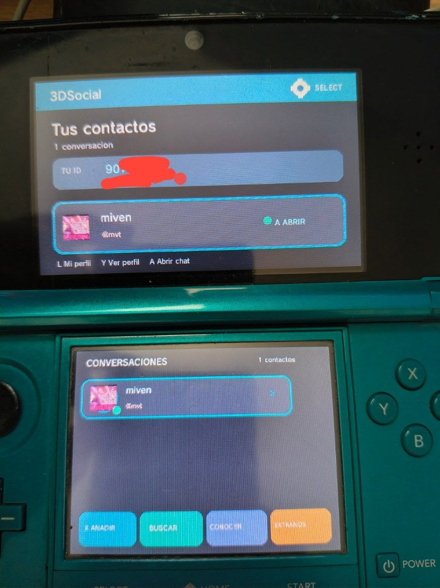

The main contacts screen of the current version. The top screen shows the **3DSocial** header, the **Your ID** card for sharing it, and the contact card with their profile picture and a presence dot (green for recent activity, gray when there is no valid heartbeat). The screen footers list the shortcuts: **L** opens your profile, **Y** the contact's profile and **A** opens the chat. The bottom screen shows the **Conversations** list with the number of contacts and four action buttons: **X Add** (add by ID), **Search** (find users by name or nickname), **Meet** (people open to new contacts) and **Strangers** (messages from senders outside your list).

### Chat: messages, media and history

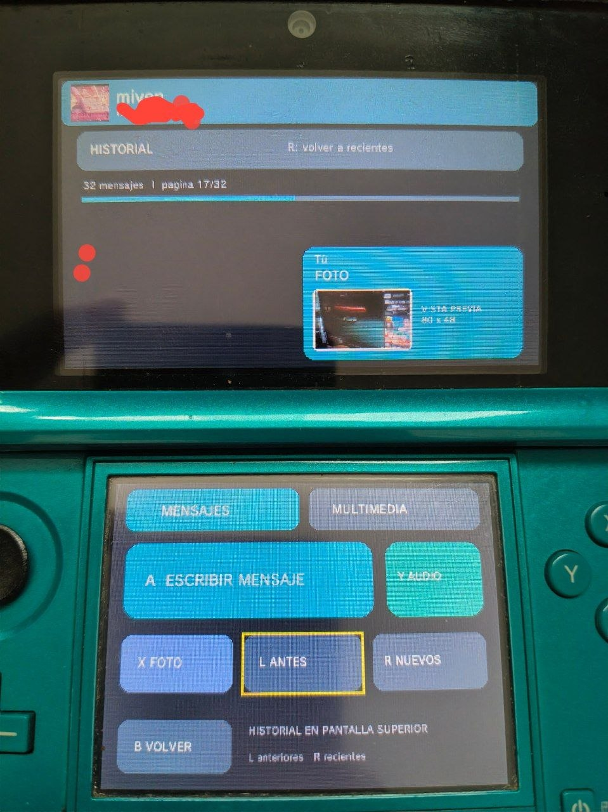

The chat in **History** mode. The top screen shows the header with the contact, the counter «52 mensajes | página 17/32» (52 messages, page 17 of 32) with a progress bar, and the messages of that page; the sent photo appears as a **Tú / FOTO** (You / PHOTO) bubble with its thumbnail preview and a **View large** option. The bottom screen keeps the **Messages** tab with **A Write message**, **Y Audio**, **X Photo**, **L Earlier** and **R Newer** to move back and forth through the history, and **B Back** to return to the most recent messages.

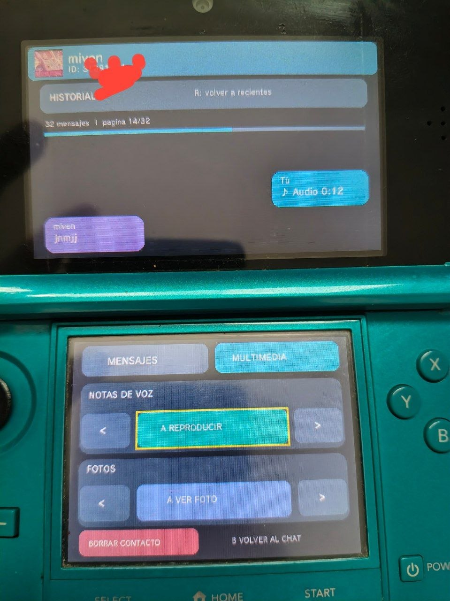

The **Media** tab of the same chat. The top screen shows one of your own voice notes («Tú / Audio 0:12») and a received text message. The bottom screen gathers two sections: **Voice notes** with **A Play** and arrows to switch between audios, and **Photos** with **A View photo**. The red **Delete contact** button and **B Back to chat** complete the screen; the paginated history of the previous photo is also reached from here.

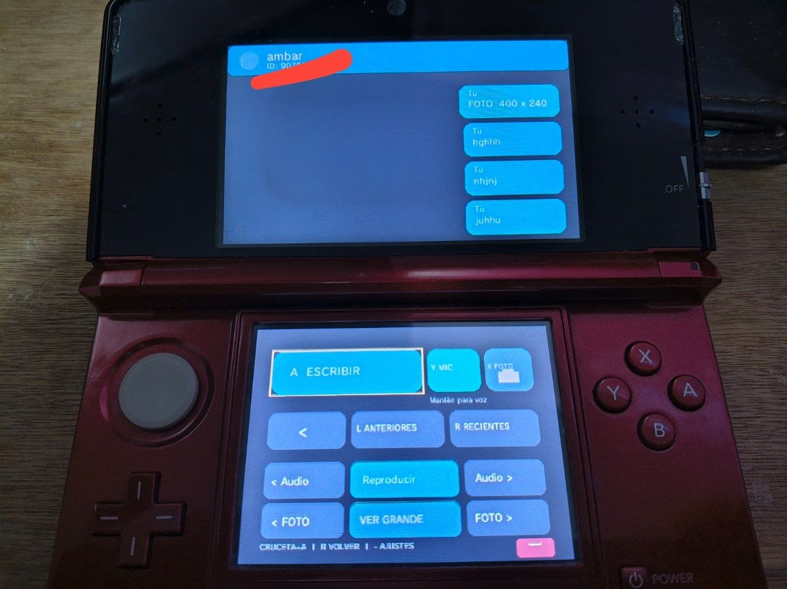

This photo shows an earlier version of the chat controls. It already had the conversation on the top screen with the history progress and the green up-to-date notice, plus large buttons to write, record audio, take photos and browse the history with **L/R**. The **Media** tab already gathered audio and photos: changing the selection makes the chat show the corresponding message. Photos have an 80×48 preview inside the bubble and a new message gets a brief visual alert.

### Camera and preview

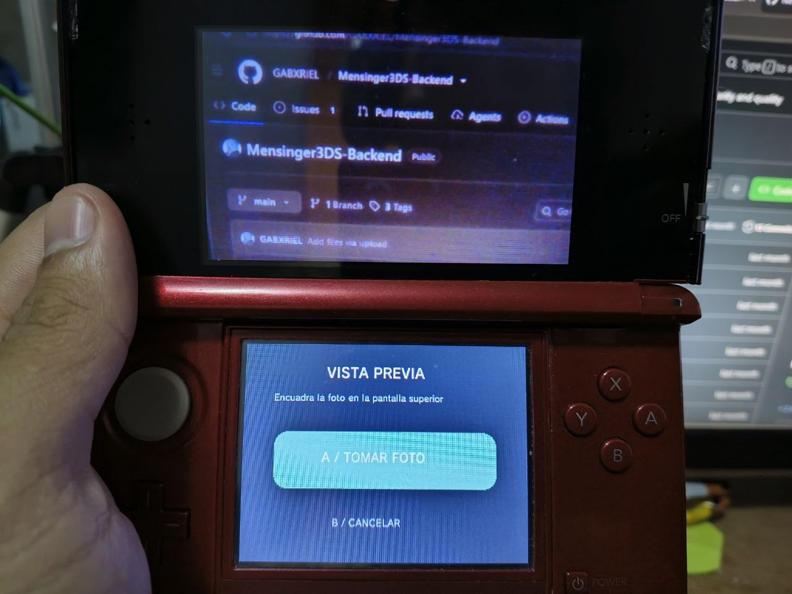

The camera shows the live image on the top screen. On the bottom screen you take the photo with **A** or cancel with **B**; after capturing it, the app lets you review it before sending.
The live image, the photos and their thumbnails keep the correct red and blue channels of the camera's RGB565 format. Photos saved with previous versions are shown with corrected colors once you install this release.

### Search, Meet people and Strangers

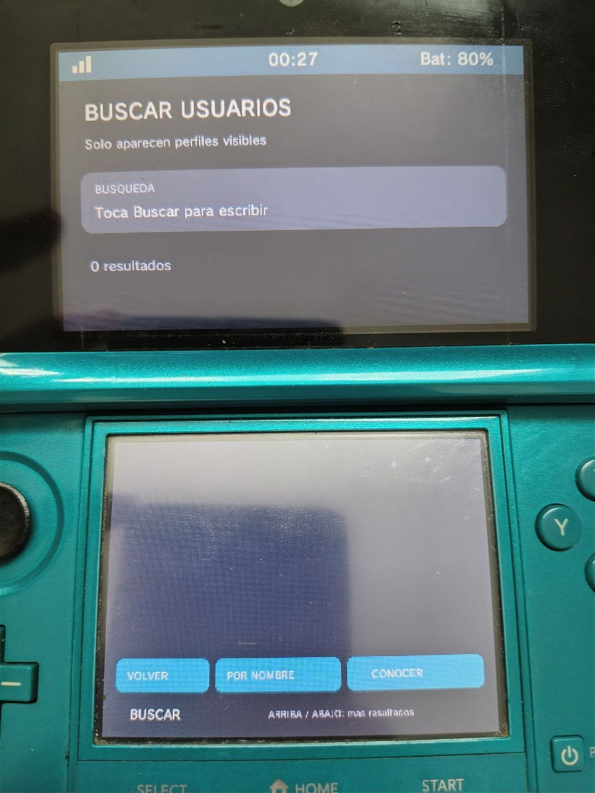

**Search users** only lists profiles that enabled **Appear in searches**. The top screen says «Toca Buscar para escribir» (tap Search to type) and shows the result counter; the bottom screen offers **Back**, **By name** to open the keyboard and **Meet** to switch to the other discovery mode. The search matches partial name or nickname hits, ignoring case and accents, and results are capped at 20.

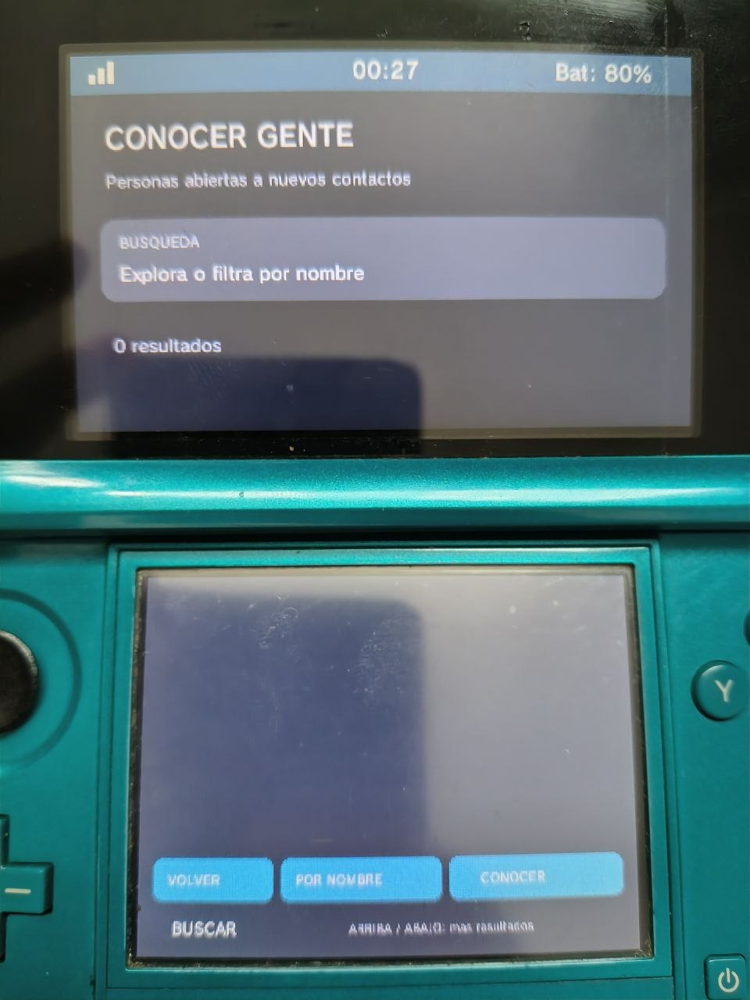

**Meet people** is the other side of the search: only profiles with the **Appear in Meet** option enabled show up here. The layout is the same — optional name search, result counter and the same navigation buttons. From a result you can open the profile and add that person as a contact.

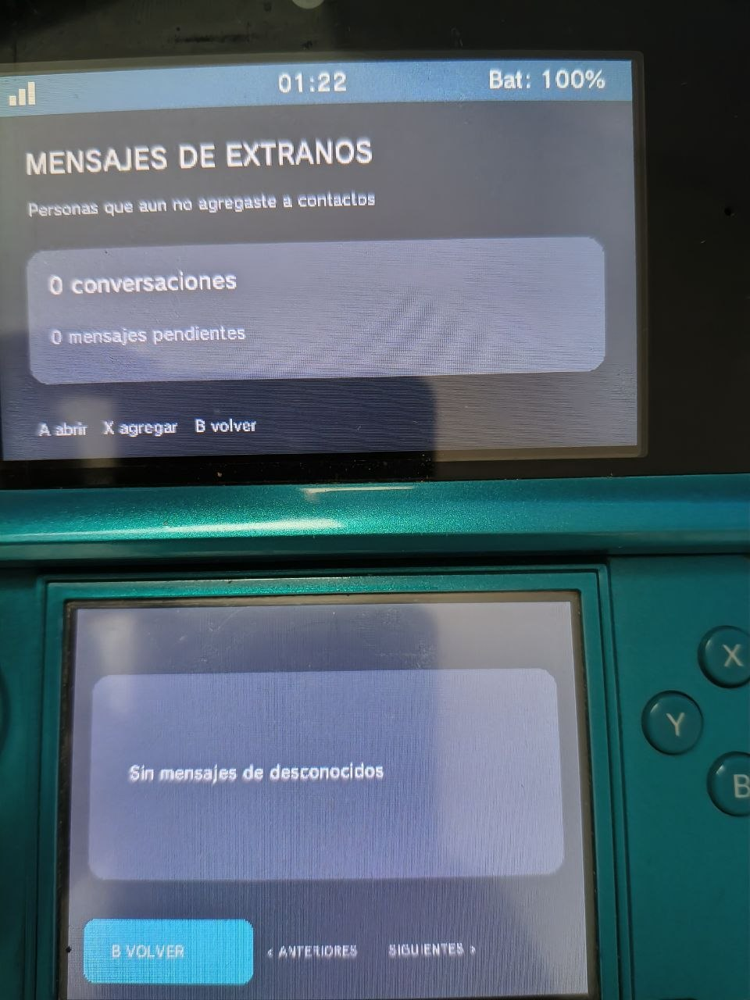

**Strangers messages**: the inbox for senders not in your local list. The top screen summarizes «0 conversaciones / 0 mensajes pendientes» (0 conversations / 0 pending messages) and the bottom screen shows the empty state with **Back** and the **Earlier / Later** pagination. With pending messages, each conversation opens with **A** to read and reply without adding the sender, and **X** saves them as a contact. The counters update without consuming the messages; opening the chat marks them as read on the server. The server stops showing a console as online after 60 seconds without a heartbeat. To use this inbox and presence, update both the server and the console to this version.

### Profile editor

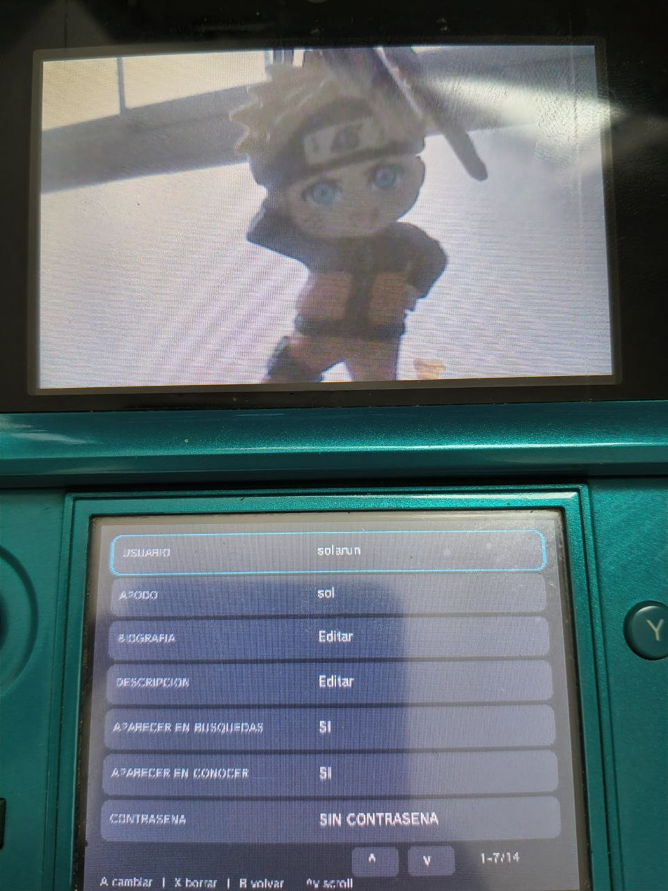

First page of the profile editor (1/7 of 14 fields), reached from **Contacts → L / My profile**. The top screen acts as the live camera viewfinder for the profile picture. The bottom screen edits **User**, **Nickname**, **Bio**, **Description**, **Appear in searches**, **Appear in Meet** and **Password**; **A** changes the selected field, **X** clears it and **B** goes back.

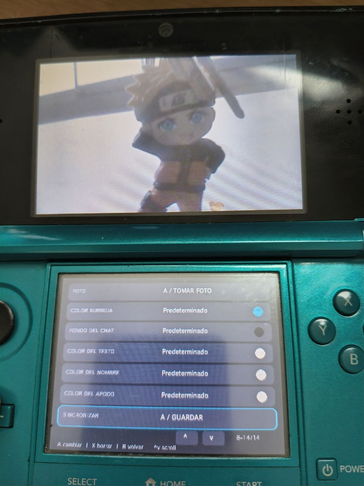

Last page of the editor (fields 5–14 of 14): **Photo** with **A / Take photo** and the visual customization of the chat: **Bubble color**, **Chat background**, **Text color**, **Name color** and **Nickname color**. **Sync / A Save** publishes the changes; your contacts will see those colors once they sync your profile.

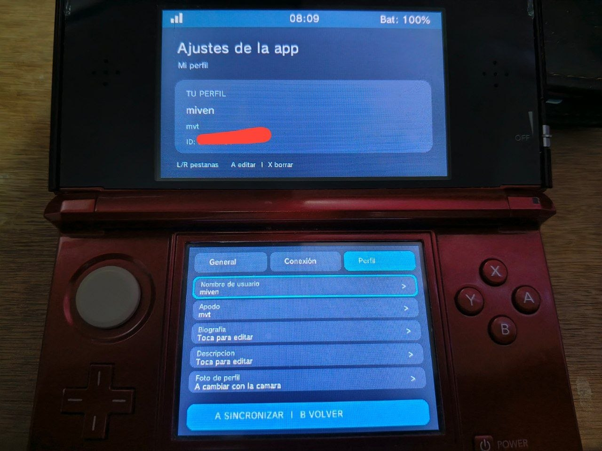

This photo shows an earlier version of the settings, when the profile was also edited from the **Profile** tab of the settings screen, with username, nickname, bio, description and profile picture taken with the camera, plus the **Sync** button. In the current version the profile is edited from **Contacts → L**, as shown in the two photos above.

### App settings

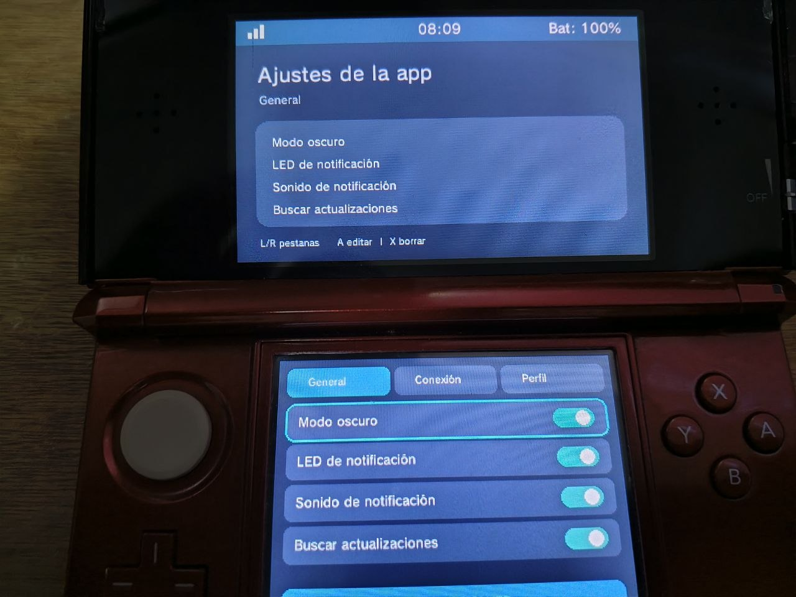

Here you enable dark mode, the LED, the notification sound and update checks. To hear the chime, **Notification sound** must be enabled and the DSP must be prepared as explained below.

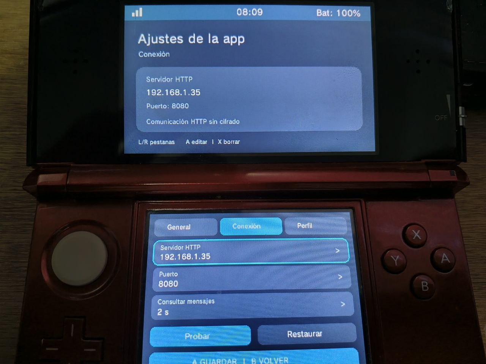

The **Connection** tab lets you type the server address and port, change the polling interval, turn application-layer encryption over HTTP on or off, test the connection and save the settings. The `192.168.1.35` address in the photo is just a local network example.

### Earlier versions

Photos of previous builds kept in the library to compare how the interface evolved.

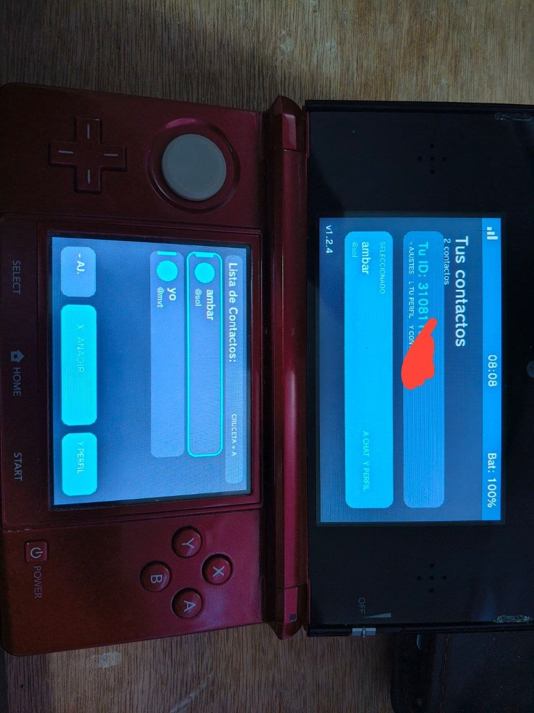

The contacts list of **v1.2.4**: the top screen showed the selected contact and your ID, and the bottom screen the list with **Add**, **Profile** buttons and the way to settings. In the current version this screen became the contacts and conversations screen of the first photo in this guide.

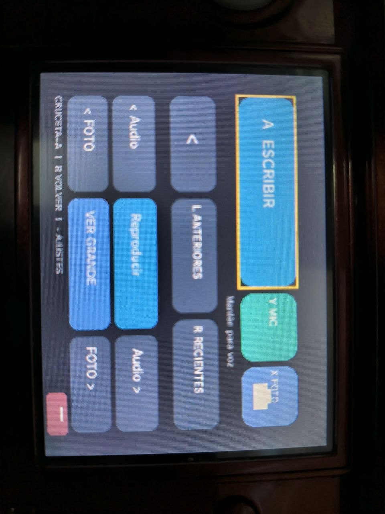

Close-up of the chat action bar from that era: **A Write**, **Y Mic** (hold for voice), **X Photo**, the **L Earlier / R Recent** navigation and the audio and photo selectors with **Play** and **View large**.

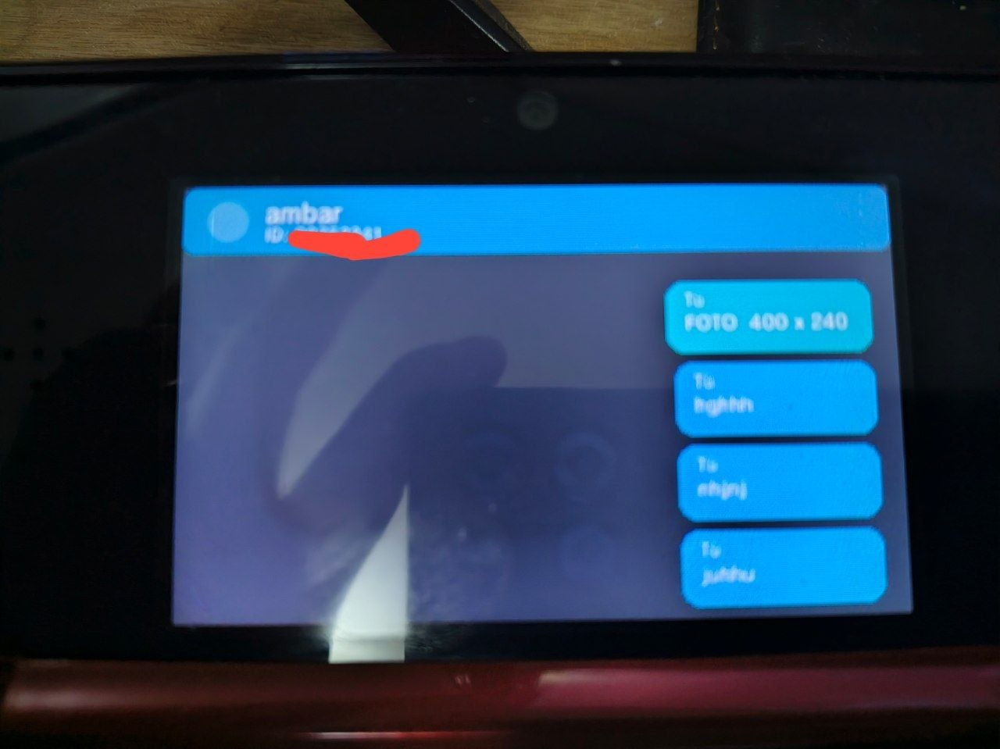

The conversation on the top screen of that version: your own bubbles («Tú», meaning You) in blue and the sent photo as a highlighted bubble labeled with its dimensions (400×240).

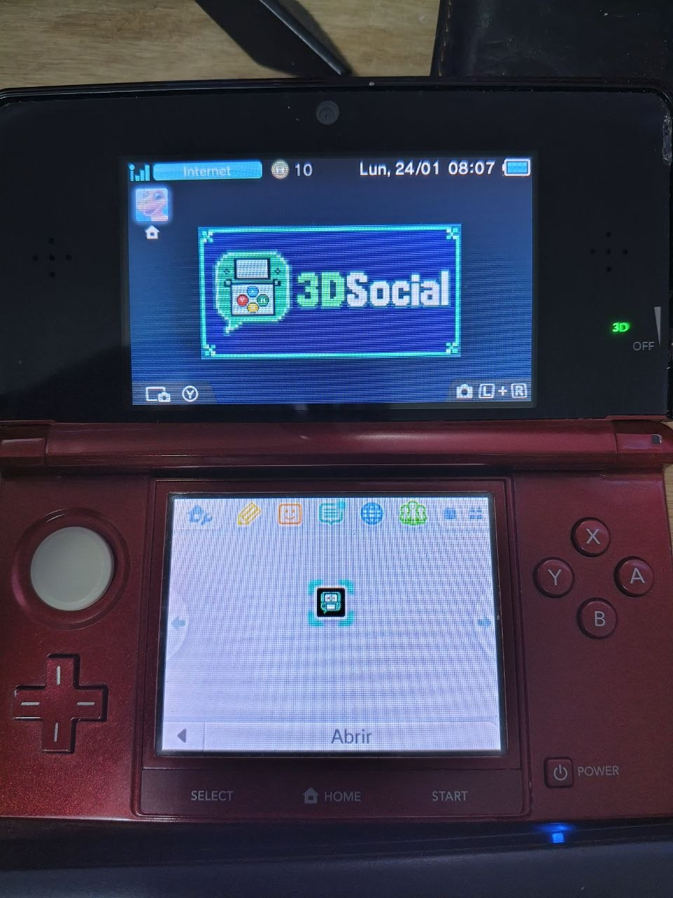

The 3DSocial banner on the top screen and the application icon selected on the HOME menu of a red 3DS, as it looks after installing the `.cia` with FBI.

## Requirements

- A Nintendo 3DS/2DS capable of running homebrew. To install the `.cia` you need a title installer, such as FBI.
- An SD card and a network connection between the console and the chosen server.
- **For audio playback:** the DSP component required by `ndsp`. The method recommended in this guide is generating `sd:/3ds/dspfirm.cdc` from Rosalina.
- To run the example server: Python 3.8 or later with `cryptography` on a computer in the same network.

## Prepare the audio with Rosalina

3DSocial uses libctru's **NDSP** audio library for the chime and the voice notes. If the DSP component is missing, NDSP initialization may fail and the audio will not work. libctru looks for the `sd:/3ds/dspfirm.cdc` file on the SD card; Rosalina can generate it directly from the console. [NDSP code in libctru](https://github.com/devkitPro/libctru/blob/master/libctru/source/ndsp/ndsp.c), [dump option in Luma3DS](https://github.com/LumaTeam/Luma3DS/blob/master/sysmodules/rosalina/source/menus/miscellaneous.c).

**We recommend Luma3DS 11.0 or later** to follow these instructions. Rosalina is the menu built into Luma3DS, not a separate program with its own version 11. The dump feature existed as early as Luma3DS 10.3; therefore the technical requirement for this audio is having the DSP component, not a specific version number. [Official Luma3DS 10.3 notes](https://github.com/LumaTeam/Luma3DS/releases/tag/v10.3).

Dump it once on your own 3DS:

1. Turn the console on and open the HOME menu.
2. Press **L + Down on the D-pad + Select** at the same time to open **Rosalina**. This is the default combination; if you changed it, use the one listed in your Luma3DS configuration.
3. Enter **Miscellaneous options**.
4. Select **Dump DSP firmware** and wait for the success message.
5. Press **B** to go back and press **B** again to close Rosalina.
6. If you have access to the SD card, check that `sd:/3ds/dspfirm.cdc` exists. Open 3DSocial again and try a voice note or the notification sound.

The [3DS Hacks Guide](https://3ds.hacks.guide/finalizing-setup) documents the same button combination and dump option. If Rosalina does not open, check your Luma3DS version and configured combination; **Select while booting** opens the Luma3DS configuration, while **L + Down + Select with the console on** opens Rosalina. [Basic Luma3DS usage](https://github.com/LumaTeam/Luma3DS#basic-usage).

The DSP file comes from your console. There is no need to include it in this repository or distribute it with the app. If the audio still does not work, confirm the dump finished correctly, that the file is on the SD card used by the app, and that **Sound** is enabled in the 3DSocial settings.

## Installing 3DSocial

Download the binaries from the [GitHub Releases](https://github.com/miventech/3DSocial---Mensajeria-para-Nintendo-3DS/releases). The repository excludes `.cia` and `.3dsx` files from the code history; these files are attached to the published release. Choose one of the formats:

| Format | Installation | Launch |
| --- | --- | --- |
| `3DSocial.cia` | Copy it to the SD card and install it with FBI | 3DSocial icon on the HOME menu |
| `3DSocial.3dsx` | Copy it to `sd:/3ds/3DSocial/3DSocial.3dsx` | Homebrew Launcher |

The CIA uses Title ID `000400000F9F8F01`, product code `CTR-P-3DSC` and company code `MV` (Miventech), different from Mensinger 3DS's. If you install both, they may appear as separate applications.

## First use and server connection

1. Connect the 3DS to the same network as the server. Your ID is generated the first time you open the app; share it with the person you want to add.
2. For a local test, start [the example server](ServerExample/README.md) on your computer. On Windows, open `ServerExample/IniciarServidorConCifrado.bat` for HTTP with encrypted data or `ServerExample/IniciarServidorSinCifrado.bat` for plain HTTP; from a terminal you can also run:

   ```powershell
   cd ServerExample
   py -3 -m pip install cryptography
   py -3 server.py --port 8080
   ```

3. Find that computer's local IPv4 address, for example with `ipconfig` on Windows. In 3DSocial open **Configuración → Conexión** (Settings → Connection) and type only the host, for example `192.168.1.50`, with no scheme or trailing slash. Use port `8080`. If you opened the encrypted `.bat`, leave **Cifrar conexión: SI (HTTP cifrado)** (Encrypt connection: YES): the app saves the server's public key automatically. If you opened the plain `.bat`, select **NO (HTTP)**.
4. Press **Probar** (Test) and save the settings. Keep the server terminal open while you use the chat. If the firewall asks for permission for Python, allow access on the private network.
5. Press **Añadir contacto** (Add contact), type their numeric ID and a name. Select the contact to open the conversation.

The app ships with `gabxriel.pythonanywhere.com:80` preconfigured, but the encrypted channel is enabled by default and requires an updated server. Configure the example server or select **Cifrar conexión: NO (HTTP)** for an older compatible server; on the initial error screen you can press **L** to toggle the mode. Plain mode transmits content and passwords over the network without protection. For the multimedia features, the server must implement the routes described in [ServerExample](ServerExample/README.md). `127.0.0.1` on the 3DS points to the console itself, not to your computer.

## Main controls

| Screen | Action |
| --- | --- |
| Contacts | Tap a contact or select it with the D-pad and **A** to open the chat; **X** adds a contact; **Y** opens their profile; **L** opens your profile. The gear on the top screen indicates **SELECT** to open Settings. |
| Chat, Messages tab | **A** writes; hold **Y** to record and release to send; **B** cancels the recording or goes back; **X** opens the camera. **L/R** switches between earlier and recent messages. |
| Chat, Media tab | Tap the tab to choose and play voice notes or open photos. The D-pad and **A** also move through its controls; **B** returns to Messages. |
| Camera | **A** takes the photo; on the confirmation view, **A** sends it, **X** retakes it and **B** discards it. |
| My profile | From Contacts, **L** opens the profile editor. **A** changes the selected option, **X** clears the selected field and **B** goes back. |
| Settings (SELECT) | Only includes **General** and **Connection**. **L/R** switches between those tabs and **B** goes back. |

The touch screen shows the available actions. **Start** closes the application outside the initial screen. Unsent voice notes can be kept as pending to retry sending.

## Building from source

You need devkitPro with **devkitARM**, **libctru**, **citro2d**, the `3dsxtool`, `smdhtool`, `bannertool` and `makerom` tools, plus the `ctr-led-brary` library included in this project. The Makefile builds the LED library from its source; the local `bannertool.exe` executable and the other generated binaries are not published in the repository.

Place the project in a path **without spaces**: the current Makefile invokes an internal build using the working path and does not escape spaces in that path. With the devkitPro environment configured:

```sh
make
make cia
```

`make` generates `3DSocial.3dsx`, `3DSocial.elf` and `3DSocial.smdh`. `make cia` also generates `3DSocial.cia` using the icon, the banner and the [app.rsf](app.rsf) configuration. Output files and the `build/` folders are excluded by `.gitignore`.

## Repository layout

| Path | Contents |
| --- | --- |
| `source/app/` | Entry point, shared state, startup and controls. |
| `source/gui/` | Texts, components and screens. |
| `source/system/` | Contacts, settings and history on the SD card. |
| `source/network/` | HTTP connection, messages and profiles. |
| `source/crypto/` | Monocypher, the portable cryptography library bundled for 3DS. |
| `source/media/` | Camera, photos, recording, playback and notification sound. |
| `ServerExample/` | Example Python server and tests; stores messages and media in SQLite. |
| `ctr-led-brary/` | Library used for LED notifications. |

The example server uses HTTP with an encrypted envelope by default and allows plain HTTP if you disable it. The first public key is obtained automatically through trust on first use; that first connection can be impersonated by someone controlling the network. Profiles with a password require authentication, but those leaving that field empty allow access with just their ID. [Server details](ServerExample/README.md).

To understand the app's full flow, the HTTP contracts, transport and SQLite encryption, authentication, media formats and the monitor, see the [technical documentation](docs/DOCUMENTACION_TECNICA.md).

## Origin and acknowledgements

3DSocial grew from the base and the idea of [Mensinger3DS-Backend](https://github.com/GABXRIEL/Mensinger3DS-Backend), created by [GABXRIEL](https://github.com/GABXRIEL). It is the parent project and the inspiration for this tool. Thanks to GABXRIEL for that original work and for paving the way to keep experimenting with messaging on Nintendo 3DS.

Thanks also to the communities and tools of **devkitPro/libctru**, **Luma3DS/Rosalina**, **PabloMK7** for `ctr-led-brary` (license in [its README](ctr-led-brary/README.md)), **Monocypher** for the cryptography library (license in [MONOCYPHER-LICENSE.md](source/crypto/MONOCYPHER-LICENSE.md)) and the **FBI** project, whose camera capture flow is acknowledged in [THIRD_PARTY_FBI_LICENSE.txt](THIRD_PARTY_FBI_LICENSE.txt).

This project is shared for **educational and fun** purposes. It is not affiliated with Nintendo.

## License and credits when reusing the code

The material over which Miventech holds rights or authorization to license is offered under the [PolyForm Noncommercial License 1.0.0 with an added attribution condition](LICENSE). You may use, modify and distribute it for **noncommercial purposes** — personal projects, research, education, charities and hobby work — as long as you keep the license notice and include a visible credit such as **«Based on 3DSocial by Miventech»** in the README, the credits, the «About» screen or the download page. **Commercial use, including selling the software, is reserved exclusively to Miventech**; to negotiate a commercial license, contact Miventech through the repository.

Third-party rights remain subject to their respective terms. Also keep the corresponding notices, including [the notice for the code adapted from FBI](THIRD_PARTY_FBI_LICENSE.txt), and credit GABXRIEL where appropriate for the original base.
