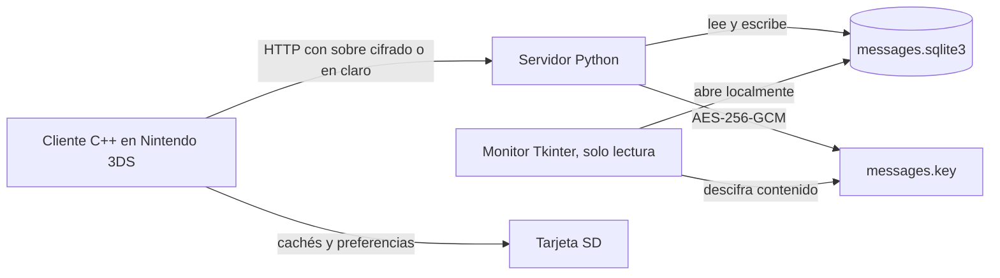

# Documentación técnica de 3DSocial

Esta guía explica cómo se relacionan la aplicación homebrew de Nintendo 3DS, el servidor de ejemplo, la base SQLite y el monitor de escritorio. El README principal cubre instalación y controles; aquí se documentan los flujos internos, los formatos de intercambio y las decisiones de seguridad.

## Mapa general



El servidor convierte cada solicitud HTTP en una operación validada sobre SQLite. El canal de aplicación cifra ruta, cabeceras sensibles y cuerpo cuando está activado; AES-GCM protege campos de contenido guardados en SQLite en ambos modos. El monitor no se conecta al servidor: abre una copia o la base local directamente en modo de solo lectura.

## Ciclo de inicio de la aplicación

1. `source/app/main.cpp` inicializa gráficos, entradas, red, generador criptográfico de 3DS, audio y LED.
2. `source/system/Storage.cpp` carga el ID de `sdmc:/3ds/Mensinger3DS/Mensinger3DS_ID.txt`, o genera uno si todavía no existe. El ID se conserva entre ejecuciones y reinstalaciones mientras no se borre ese archivo.
3. La misma carpeta contiene `config.ini`, contactos y cachés. Se cargan antes de presentar la pantalla inicial.
4. `source/app/Startup.cpp` comprueba el servidor. Primero consulta `/version`; después consulta `/acceso/<id>`. Una cuenta sin contraseña queda habilitada directamente. Una cuenta protegida solicita la contraseña y obtiene un token mediante `POST /acceso/<id>`.
5. Si se habilitaron las actualizaciones, el cliente compara el texto de `/version` con `VERSION_ACTUAL` y muestra el aviso cuando la versión remota es superior.
6. El bucle de `main.cpp` lee botones y pantalla táctil, actualiza operaciones pendientes y dibuja la pantalla activa. Los estados de interfaz están enumerados en `EstadoApp` y los estados de conexión inicial en `EstadoInicio`.

Si cambia el host, puerto o modo de cifrado mientras la app está abierta, el token asociado a la conexión anterior se descarta y el cliente vuelve a ejecutar el inicio.

```mermaid
sequenceDiagram
    participant C as 3DSocial
    participant S as Servidor
    participant DB as SQLite
    C->>S: GET /clave-servidor
    S-->>C: Clave pública y desafío de un solo uso
    Note over C: Fija o compara clave por host y puerto
    C->>S: POST /canal (GET /version cifrado)
    S-->>C: Versión cifrada
    C->>S: POST /canal (GET /acceso/{id} cifrado)
    S->>DB: Crear perfil vacío si no existe
    S-->>C: LIBRE o PROTEGIDO
    opt Perfil protegido
        C->>S: POST /canal (contraseña cifrada)
        S->>DB: Leer salt y hash; comparar PBKDF2
        S-->>C: Token bearer de sesión
    end
    C->>S: POST /canal (mensaje y token cifrados)
    S->>DB: Cifrar body con AES-GCM y guardar
    S-->>C: OK
```

## Organización del código de Nintendo 3DS

| Archivo o grupo | Responsabilidad y flujo |
| --- | --- |
| `source/app/main.cpp` | Inicializa servicios, prepara ID y preferencias, ejecuta el ciclo por fotograma y libera recursos al salir. |
| `source/app/AppState.hpp` / `AppState.cpp` | Define estados de pantalla, modelos compartidos, preferencias, sesión, historial y prototipos utilizados por las demás capas. Los valores `extern` tienen su almacenamiento real en `AppState.cpp`. |
| `source/app/Startup.cpp` | Presenta conexión, autenticación, actualización disponible y errores; permite corregir host/puerto o alternar cifrado/en claro. |
| `source/app/Input.cpp` | Traduce botones y toques a acciones; gestiona selección, grabación mientras se mantiene pulsado el control, pestañas, desplazamiento y navegación. |
| `source/gui/Screens.cpp` | Dibuja la lista de contactos, chat, multimedia, búsqueda, Conocer gente, perfil y ajustes en las dos pantallas. |
| `source/gui/ChatView.cpp` | Construye burbujas, envuelve texto UTF-8, dibuja historiales y anima solamente el mensaje señalado por su ID o índice. |
| `source/gui/Widgets.cpp` | Dibuja controles reutilizables, opciones, barra superior, engranaje, teclado de texto/contraseña y paletas del perfil. |
| `source/gui/Localization.cpp` | Selecciona idioma de sistema y resuelve `TextoID` desde las tablas de texto. Las entradas del enum y las tablas deben conservar el mismo orden. |
| `source/system/Storage.cpp` | Mantiene ID, contactos y preferencias en la SD; también valida host y forma el encabezado `Host`. |
| `source/system/Conversation.cpp` | Conserva compatibilidad con el chat de texto antiguo, consulta notificaciones, administra caché de historial nuevo y construye rutas locales por servidor. |
| `source/network/Connection.cpp` | Abre sockets con límite de espera, consulta versión y controla la luz LED. |
| `source/network/MessagingV2.cpp` / `.hpp` | Implementa HTTP en claro para compatibilidad, lectura de respuestas, historial paginado y transferencias de audio/foto. |
| `source/network/HttpSecure.cpp` / `.hpp` | Construye el sobre cifrado, fija la clave pública, usa el RNG de 3DS, valida la respuesta y realiza HTTP exterior. |
| `source/crypto/monocypher.c` / `.h` | Biblioteca Monocypher 4.0.2 para X25519, BLAKE2b y ChaCha20-Poly1305. Su licencia está en `source/crypto/MONOCYPHER-LICENSE.md`. |
| `source/network/Profile.cpp` | Sincroniza perfil, contraseña y resultados de búsqueda; carga perfiles y miniaturas de contactos. |
| `source/media/CameraPhotos.cpp` / `.hpp` | Captura cámara de forma asíncrona y convierte buffers RGB565 lineales a texturas Citro2D con orden Morton. Gestiona imagen ampliada y miniaturas. |
| `source/media/ChatMedia.cpp` | Crea caché de miniaturas, salta al mensaje de un medio, abre fotos, reproduce audio, y confirma/reintenta envíos pendientes. |
| `source/media/VoiceNotes.cpp` / `.hpp` | Captura micrófono, escribe WAV PCM mono de 16 bits a 10 910 Hz y reproduce archivos recibidos. |
| `source/media/NotificationAudio.cpp` | Extrae el WAV predeterminado a la SD si falta, carga NDSP y reproduce o libera el sonido de aviso. |
| `source/media/sonido_campanita.h` | Contiene los bytes WAV incluidos que se copian la primera vez. |
| `source/system/LocalMode.cpp` / `.hpp` | Pantalla marcadora para modo local futuro; actualmente no descubre consolas ni envía mensajes. |

### Estado compartido

`AppState.hpp` agrupa el estado que cruza pantallas y capas. Las variables se organizan así:

- **Preferencias y conexión:** tema, LED, sonido, comprobación de actualización, host/puerto, disponibilidad de RNG, modo cifrado y estado de prueba.
- **Identidad y sesión:** `miID`, token, host/puerto/modo asociados al token y bandera de cuenta protegida.
- **Perfil:** campos locales, foto y rutas pendientes, permisos de búsqueda/conocer y cinco índices de color (0–5).
- **Contactos y descubrimiento:** contactos cargados, contacto activo, resultados de búsqueda, filtro, modo de búsqueda y posiciones de scroll.
- **Chat:** historial heredado, historial `MensajeV2`, IDs visibles, total, cursor de páginas, posición actual, estado de carga y selección multimedia.
- **Medios y avisos:** archivo pendiente/error, estado de envío, duración/tiempo, miniaturas y foco de navegación.

Las rutas públicas de audio/foto están declaradas en sus headers específicos. Las demás funciones compartidas se declaran al final de `AppState.hpp`; el archivo es la interfaz común del cliente, no una clase orientada a objetos.

### Historial paginado y vistas multimedia

El cliente detecta si el servidor soporta `/historial` y conserva `MensajeV2` con ID persistente, remitente, texto, duración y tipo. `before=0` solicita los mensajes más recientes; para ir hacia atrás se usa como cursor el ID del mensaje más antiguo ya cargado. El servidor devuelve cada página en orden cronológico. El cliente fusiona por ID para que una actualización no duplique mensajes y guarda una caché separada por servidor, usuario y contacto.

Si el servidor responde con un estado antiguo/incompatible para `/historial`, el cliente marca que ese servidor solo ofrece el protocolo heredado y recurre a `/obtener_chat`; en ese modo se conservan textos, pero no se habilitan las funciones multimedia que requieren la API nueva.

La parte visible y el total de la conversación se consultan por separado. La barra superior informa de la posición en el historial y destaca la posición más reciente. La animación de llegada usa el ID del mensaje (o un índice para el protocolo antiguo), evitando animar todas las burbujas al mover la selección.

Las pestañas **Mensajes** y **Multimedia** comparten el mismo historial. Al seleccionar una foto o audio, `ChatMedia.cpp` busca su ID en los mensajes cargados; si está en otra página, pide páginas anteriores hasta encontrarlo y desplaza la conversación a esa posición. Las miniaturas pequeñas se cargan primero; la foto RGB565 completa se descarga únicamente al abrirla.

## Servidor Python

### Archivos

| Ruta | Función |
| --- | --- |
| `ServerExample/server.py` | CLI, esquema SQLite, manejadores HTTP, autorización, validaciones, búsqueda, historial y medios. |
| `ServerExample/secure_store.py` | Cifrado AES-256-GCM, lectura/escritura de clave y migración del contenido previo. |
| `ServerExample/secure_channel.py` | Identidad X25519 persistente, desafíos únicos, autenticación y formato de sobres cifrados. |
| `ServerExample/tls_setup.py` | Código histórico de certificados; el servidor HTTP actual no lo invoca. |
| `ServerExample/IniciarServidor.bat` | Busca Python 3.8+, verifica `cryptography` e instala esa dependencia si falta. |
| `ServerExample/IniciarServidorConCifrado.bat` | Llama al launcher con `--cifrado-conexion si` (HTTP con sobre cifrado). |
| `ServerExample/IniciarServidorSinCifrado.bat` | Llama al launcher con `--cifrado-conexion no` (HTTP); SQLite continúa cifrado. |
| `ServerExample/test_server.py` | Pruebas automatizadas de rutas, almacenamiento, autorización, medios y modos de transporte. |

`MensingerServer` inicia la base de datos cifrada y mantiene las sesiones en memoria. `MensingerHandler` despacha `GET` y `POST`. Cada operación abre una conexión SQLite corta mediante `open_database`; el contexto confirma la transacción si termina bien y la revierte ante una excepción. El servidor concurrente atiende solicitudes en hilos, mientras SQLite aplica un tiempo de espera ante bloqueos.

### Esquema de datos

| Tabla | Columnas principales | Protecciones |
| --- | --- | --- |
| `messages` | `id`, remitente, destinatario, cuerpo, tipo, duración, fecha, estado de notificación, audio/foto/miniaturas y dimensiones | `body`, `audio_data`, `image_data`, `image_thumb` se cifran con AES-GCM. IDs, tipo, fechas, duración, dimensiones y estado de notificación quedan consultables en claro. |
| `profiles` | ID, nombre, apodo, bio, descripción, foto/miniatura, fecha, contraseña, visibilidad y colores | Fotos y miniaturas se cifran. Contraseña se guarda como sal aleatoria más derivado PBKDF2. Los datos de perfil y búsqueda quedan en claro para poder consultarlos. |

El esquema se crea o amplía al iniciar. La migración cifra por lotes filas que todavía están en claro. Una vez actualizadas, activa `secure_delete` y ejecuta `VACUUM` para retirar páginas liberadas de la base. Antes de actualizar, conviene detener el servidor y hacer una copia de seguridad.

### Cifrado de contenido de SQLite

`secure_store.py` implementa cifrado autenticado, no un cifrado de toda la estructura SQLite:

1. Si todavía no hay clave, crea `messages.key` junto a la base (o en la ruta indicada por `--key`) con 32 bytes aleatorios. El archivo debe permanecer privado.
2. Cada campo obtiene un nonce aleatorio de 12 bytes y se cifra con AES-256-GCM.
3. El AAD incluye tabla, identidad de fila, columna y versión (`Mensinger3DS:<tabla>:<id>:<columna>:v1`). Esto impide mover una celda cifrada a otra fila o columna sin que falle la autenticación.
4. Los BLOB llevan el marcador `MP1`, nonce y ciphertext/tag. El texto se codifica en UTF-8, pasa por el mismo formato binario, se codifica Base64 URL-safe y lleva el prefijo `enc:v1:`.
5. Al leer, un prefijo ausente, una clave equivocada, alteración o AAD incorrecta genera error en lugar de devolver texto corrupto.

Para respaldar una instalación, copia juntos `messages.sqlite3` y `messages.key`; conservar solo uno no permite recuperar el contenido. Una clave perdida no se regenera para una base que ya contiene marcadores cifrados: el servidor se detiene para evitar sobrescribir evidencia de una clave faltante. Copias antiguas en claro requieren protección aparte. Este diseño cifra contenido seleccionado; no cifra IDs, marcas de tiempo, metadatos ni toda la base como lo haría SQLCipher.

### Canal cifrado sobre HTTP y confianza inicial

`--cifrado-conexion si` es el valor predeterminado. `secure_channel.py` genera `transport.key` con 32 bytes aleatorios una sola vez y publica únicamente la clave X25519 correspondiente. Cada `GET /clave-servidor` devuelve `M3K1 || clave_publica_servidor[32] || desafio[16]`. El desafío es aleatorio, caduca en 180 segundos y se consume una vez mediante un bloqueo compartido por los hilos del servidor. El cliente comprueba o fija la clave por host y puerto en `server-key-<host>-<puerto>.bin` antes de enviar datos de usuario.

Para cada petición, `HttpSecure.cpp` obtiene 32 bytes aleatorios del servicio `ps:ps`, calcula una clave X25519 efímera y deriva BLAKE2b-256 de `secreto_compartido || publica_cliente || publica_servidor || desafio || "Mensinger3DS-channel-v1"`. El secreto de X25519 se comprueba contra cero. El cliente no conserva su clave privada efímera y borra los buffers de secreto y clave cuando dejan de necesitarse. Monocypher implementa el AEAD ChaCha20-Poly1305 IETF; Python usa `cryptography` con el mismo algoritmo. Las pruebas `test_crypto_compat.py` cotejan ambos resultados byte a byte.

La petición interna codifica método (1 byte), longitud de ruta (2), longitud de tipo (1), longitud de ID (1), longitud de token (1), longitud de cuerpo (4), seguidos de los campos y el cuerpo. Los enteros son big endian. Su sobre externo es `M3Q1 || desafio[16] || publica_cliente[32] || tag[16] || ciphertext`. El servidor valida longitudes, ruta y autenticación antes de invocar las rutas habituales; la respuesta interior es `estado[2] || longitud[4] || cuerpo` y el sobre exterior es `M3R1 || tag[16] || ciphertext`. Los nonces IETF son doce bytes cero para petición y once ceros seguidos de `01` para respuesta; la clave derivada es distinta en cada desafío/petición. Los AAD `M3DS1Q` y `M3DS1R` impiden intercambiar una dirección por otra. El máximo del cuerpo interno es 720 000 bytes.

La primera clave llega por HTTP sin autenticación externa: alguien que suplante el servidor en ese primer instante puede fijar una clave falsa. Después la consola rechaza cambios y nunca sustituye una clave guardada silenciosamente. **R** en la pantalla de error elimina la clave fijada del host/puerto actual; úsalo solo después de confirmar por otra vía que el servidor legítimo rotó su clave. También puede preinstalarse la clave pública de 32 bytes por un canal de confianza. El servidor imprime su huella SHA-256 al arrancar. Este protocolo no ofrece secreto hacia adelante frente al robo posterior de `transport.key`, porque la clave privada del servidor es estática. HTTP exterior revela IP, tamaño, tiempo y las dos rutas de canal, pero oculta ruta interna, ID, token, contraseña, texto y multimedia. Para Internet conviene usar TLS certificado además del protocolo de aplicación.

Con `--cifrado-conexion no`, el servidor acepta las rutas HTTP antiguas en claro y no crea `transport.key`. El cifrado de contenido SQLite permanece activo en ambos modos.

### Contraseña, sesiones y límites de identidad

El servidor crea una fila de perfil la primera vez que se consulta `/acceso/<id>`. Sin hash de contraseña, responde `LIBRE`; una contraseña no vacía activa un salt aleatorio y PBKDF2-HMAC-SHA256 con 200 000 iteraciones. La contraseña original nunca se guarda. Si se establece una contraseña, `POST /acceso/<id>` compara el derivado en tiempo constante y crea un token aleatorio que solo vive en memoria del servidor. Reiniciar el proceso elimina las sesiones; cambiar la contraseña invalida las anteriores.

Las rutas privadas verifican el token `Authorization: Bearer <token>` cuando el perfil está protegido. Las descargas de medios de chat también requieren `X-User-ID` igual a uno de los participantes. Los perfiles que dejan la contraseña vacía no requieren autenticación por compatibilidad: conocer el ID basta para usar esa identidad, incluso para establecerle una contraseña. Por eso conviene definir contraseña antes de compartir un ID.

La búsqueda del perfil se controla por dos flags independientes. `show_in_search` expone el perfil al modo nombre; `meet_people` lo añade a Conocer gente. Se filtra por subcadena de nombre o apodo y se normaliza Unicode para ignorar mayúsculas y acentos. Los resultados se limitan a 20. Los campos de perfil que se buscan permanecen en claro en la base.

Los cinco índices de estilo aceptan valores de 0 a 5: `chat_color` elige la burbuja, `background_color` el fondo, `text_color` el cuerpo del mensaje, `nickname_color` el apodo y `name_color` el nombre. El valor 0 usa la apariencia predeterminada (y el tema del lector cuando corresponda); los valores 1–5 seleccionan verde, violeta, coral, dorado y grafito.

## Contrato HTTP del servidor de ejemplo

Los IDs son cadenas de 1–10 dígitos. Las solicitudes JSON deben incluir `Content-Type: application/json`; fotos usan `application/x-mensinger-bgr565`, y audio `audio/wav`. `before=0` significa comenzar desde los mensajes más recientes; los cursores siguientes excluyen el ID indicado.

El nombre `application/x-mensinger-bgr565` se mantiene por compatibilidad histórica; los bytes de las fotos son RGB565 (5 bits rojo, 6 verde, 5 azul) a 400×240.

| Método y ruta | Uso y respuesta | Acceso |
| --- | --- | --- |
| `GET /version` | Versión en texto simple. | Público |
| `GET /clave-servidor` | Clave pública y desafío de un solo uso; solo en modo cifrado. | Público, sin datos de usuario |
| `POST /canal` | Sobre cifrado para cualquiera de las rutas internas; solo en modo cifrado. | Autenticado por AEAD y por permisos de la ruta interna |
| `GET /acceso/{id}` | Crea perfil vacío si hace falta y responde `LIBRE` o `PROTEGIDO`. | Público |
| `POST /acceso/{id}` | JSON `{"password":"..."}`; valida la contraseña y devuelve token. | Público para iniciar sesión |
| `POST /contrasena/{id}` | Define o quita contraseña con JSON; contraseña vacía la quita. | Token si ya está protegido |
| `POST /enviar` | JSON con `de`, `para`, `texto`; devuelve `OK`. | Token del remitente si está protegido |
| `GET /notificaciones/{id}` | Devuelve remitente pendiente o `NINGUNO` y marca las del remitente elegido como entregadas. | Token si está protegido |
| `GET /remitentes/{id}` | Hasta 80 remitentes recibidos, con pendientes, total y último ID en TSV; no consume avisos. | Token si está protegido |
| `POST /presencia/{id}` | Renueva el latido temporal de la consola. | Token si está protegido |
| `GET /presencias/{id}?ids={id1,id2,...}` | Estado 1/0 de hasta 50 IDs; vence a los 60 s. | Token del primer ID si está protegido |
| `GET /conteo/{id}/{contacto}` | Total de mensajes intercambiados. | Token del primer ID si está protegido |
| `GET /obtener_chat/{id}/{contacto}` | Formato histórico de texto `[remitente]: texto`, últimos mensajes dentro del límite antiguo. | Token del primer ID si está protegido |
| `GET /historial/{id}/{contacto}?before={id}&limit=20` | Una página cronológica TSV de hasta 20 mensajes de cualquier tipo. | Token del primer ID si está protegido |
| `POST /audio/{remitente}/{destinatario}` | WAV mono PCM 16-bit, 10 910 Hz, máximo 30 s; devuelve ID de mensaje. | Token del remitente si está protegido |
| `GET /audio/{mensaje}` | WAV del mensaje. | Participante + token si está protegido |
| `POST /foto/{remitente}/{destinatario}` | Foto RGB565 400×240 (192 000 bytes); devuelve ID de mensaje. | Token del remitente si está protegido |
| `GET /foto/{mensaje}` | Foto RGB565 completa. | Participante + token si está protegido |
| `GET /foto-miniatura/{mensaje}` | Foto RGB565 80×48; se crea al vuelo si falta. | Participante + token si está protegido |
| `POST /perfil/{id}` | JSON con textos, flags de visibilidad y cinco colores 0–5. | Token si está protegido |
| `GET /perfil/{id}` | JSON del perfil, estilos y bandera `has_photo`. | Público |
| `GET /perfiles?ids={id1,id2,...}` | TSV con hasta 50 perfiles para sincronización de contactos. | Público |
| `POST /perfil/{id}/foto` | Sube foto RGB565 400×240; crea miniatura cuadrada 32×32. | Token si está protegido |
| `GET /perfil/{id}/foto` | Foto de perfil RGB565. | Público |
| `GET /perfil-miniaturas?ids={id1,id2,id3}` | Paquete binario con máximo tres miniaturas 32×32. | Público |
| `GET /buscar?modo=nombre&q={texto}` | Coincidencia parcial entre nombre/apodo de perfiles visibles. | Público |
| `GET /buscar?modo=conocer&q={texto}` | Personas con la opción Conocer activada; filtro opcional por nombre/apodo. | Público |

`/historial` emite cinco columnas TSV por línea: ID, remitente, tipo (`texto`, `audio`, `foto`), duración en milisegundos y cuerpo descriptivo. Los contenidos binarios se descargan por sus rutas propias. `GET /perfiles` emite once columnas: ID, nombre, apodo, bio, descripción, bandera de foto y cinco colores.

## Monitor de escritorio

`IgnoreFolder/MonitorExample/monitor.py` contiene la aplicación Tkinter y una capa `MonitorDB`. Esta capa comprueba columnas requeridas, abre SQLite con URI `mode=ro` y `PRAGMA query_only=ON`, y descifra texto/audio/foto con la misma clase `ContentCipher` que usa el servidor. El monitor no necesita `transport.key` ni se conecta al canal HTTP porque lee la base local.

La interfaz lista todas las conversaciones, filtra texto/fotos/audios, busca por ID/remitente/destinatario/contenido, carga mensajes anteriores en páginas de hasta 200 y presenta perfiles. El catálogo multimedia puede filtrar por tipo, ID de mensaje o cualquiera de los IDs participantes, mostrar quién envió/recibió y saltar al mensaje asociado. Las fotos RGB565 se transforman a PNG; los WAV se reproducen con el reproductor disponible o se pueden guardar. La consulta se actualiza periódicamente, pero no altera banderas ni filas.

El filtro **Enlaces** examina el texto ya descifrado y conserva solo mensajes con URL HTTP/WWW. **Galería** consulta miniaturas cifradas (`image_thumb`) en páginas de 24 y, cuando faltan, reduce la foto original localmente. **Gráficas** agrega los últimos 30 días UTC: mensajes por tipo, altas de perfil (`profiles.created_at`) y usuarios activos únicos (remitente o destinatario). Al migrar perfiles previos, se usa `updated_at` como aproximación de alta porque el esquema antiguo no la registraba. El monitor mantiene `mode=ro` en todas estas consultas.

Se necesita la clave correspondiente a esa misma base. Si la base y clave se copian a otra carpeta, `--db` y `--key` permiten señalar ambas rutas. La clave da acceso a todo el contenido descifrable; trata el monitor y sus exportaciones como material privado.

## Archivos locales de 3DS

La carpeta raíz es `sdmc:/3ds/Mensinger3DS/`:

| Archivo o patrón | Contenido |
| --- | --- |
| `Mensinger3DS_ID.txt` | ID local persistente. |
| `Mensinger3DS_Contactos.txt` | Una línea por contacto, `id:nombre`; las líneas antiguas con solo ID siguen siendo válidas. |
| `config.ini` | Preferencias, host/puerto, modo de conexión y perfil local. La contraseña no se guarda aquí. |
| `server-key-<host>-<puerto>.bin` | Clave pública X25519 fijada para ese servidor, separada por host y puerto. |
| `chat_v2_*.txt` | Caché local de mensajes indexada por servidor/usuario/contacto. |
| `audio_*.wav`, `foto_*.bgr`, `foto_mini_*.bgr` | Medios descargados o pendientes. Los archivos de SD no están cifrados por esta implementación. |
| `perfil_*.bgr`, `perfil_pendiente_*.bgr` | Foto de perfil y foto pendiente de confirmar. |
| `campanita.wav` | Sonido de notificación; si no existe se copia el audio integrado. |

Al quitar un contacto se elimina de la lista local, pero no se borra el historial ni los medios del servidor.

Las claves de `config.ini` son `modo_oscuro`, `led`, `sonido`, `actualizaciones`, `servidor`, `puerto`, `cifrar_conexion`, `intervalo_ms`, los cuatro textos `perfil_nombre`, `perfil_apodo`, `perfil_bio`, `perfil_descripcion`, los flags `mostrar_en_busqueda` y `quiero_conocer_gente`, y `color_chat`, `color_fondo`, `color_texto`, `color_apodo`, `color_nombre`. Los campos ausentes conservan sus valores predeterminados para permitir que versiones nuevas amplíen el archivo.

## Ejecutar, compilar y mantener

En Windows se inicia HTTP con sobre cifrado con `ServerExample/IniciarServidorConCifrado.bat` y HTTP en claro con `IniciarServidorSinCifrado.bat`. Ambos necesitan Python 3.8 o superior y `cryptography`; el launcher comprueba e intenta instalar el paquete en el mismo intérprete detectado. El servidor escucha en todas las interfaces, puerto 8080 por defecto:

```powershell
cd ServerExample
py -3 server.py --port 8080
```

Las opciones relevantes son `--host`, `--port`, `--db`, `--key`, `--transport-key`, `--cifrado-conexion si|no` y `--version`. El modo de conexión no desactiva el cifrado de SQLite.

Para construir el cliente se requiere devkitPro/devkitARM, libctru, citro2d, `3dsxtool`, `smdhtool`, `bannertool`, `makerom` y la biblioteca LED incluida. Desde una ruta sin espacios y con entorno devkitPro configurado, `make` genera 3DSX y `make cia` genera el instalador CIA. La compilación no forma parte del servidor ni del monitor.

Las pruebas del servidor se ejecutan desde la raíz con `py -3 -m unittest discover -s ServerExample -p "test_*.py" -v`; incluyen un cotejo de la biblioteca C y Python cuando hay GCC disponible. Las pruebas del monitor se ejecutan desde `IgnoreFolder/MonitorExample` con `py -3 -m unittest -v test_monitor.py`; necesitan las dependencias de escritorio. Los tests validan el protocolo y almacenamiento sin requerir una consola física.

## Modelo de privacidad y límites

- El sobre cifrado protege ruta interna, credenciales, tokens y contenido entre la consola y el servidor cuando está activado. La primera clave TOFU tiene el riesgo descrito arriba y no equivale a un certificado público verificado.
- El modo HTTP en claro transmite credenciales, tokens y contenido legibles en la red.
- AES-GCM cifra en reposo los cuerpos de mensajes, audios, fotos y miniaturas listados; SQLite conserva metadatos y perfiles en claro para que la aplicación pueda consultar y buscar.
- Esto **no es cifrado de extremo a extremo**: el servidor posee `messages.key` y descifra cada contenido al atender la solicitud. Quien controle el proceso o la clave puede leerlo.
- El token reside en memoria del servidor; no hay una tabla de cuentas independiente ni recuperación de contraseña.
- Los datos descargados/cachés de la SD quedan en claro. La protección de la tarjeta y de sus copias depende del usuario.
- Las fotos de perfil, los campos de perfil y resultados de búsqueda se sirven públicamente por ID/ruta; los permisos de búsqueda controlan el directorio de descubrimiento, no convierten el perfil en privado.

Estas propiedades describen el servidor de ejemplo y el protocolo actual. Un servidor público de Internet requiere endurecer límites, control de abuso, gestión de secretos, copias de seguridad y operación antes de exponerlo.
